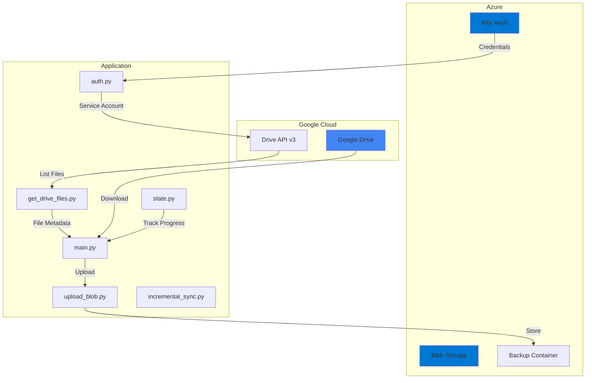

# Google Drive to Azure Blob Storage Sync

> Architecture and design rationale: [docs/ARCHITECTURE.md](docs/ARCHITECTURE.md)

[](https://www.python.org/downloads/)
[](https://opensource.org/licenses/MIT)
[](https://github.com/astral-sh/ruff)

An automated backup solution that synchronises files from Google Drive to Azure Blob Storage, with support for
incremental syncs, secure credential management via Azure Key Vault, and comprehensive logging.

## Features

- **Automated Backups**: Sync entire Google Drive folders to Azure Blob Storage
- **Incremental Sync**: Only transfer files modified since the last sync
- **Secure Credentials**: Store Google API credentials in Azure Key Vault
- **Comprehensive Logging**: File and console logging for monitoring
- **Error Handling**: Robust error handling with detailed error messages
- **MIME Type Preservation**: Maintains original file content types

## Architecture



## Project Structure

```
Google-Drive-to-Azure-Blob-Storage/
├── main.py                 # Main entry point and orchestration
├── auth.py                 # Authentication with Google & Azure
├── get_drive_files.py      # Google Drive file listing
├── upload_blob.py          # Azure Blob Storage uploads
├── create_container.py     # Container management
├── incremental_sync.py     # Change detection for incremental sync
├── state.py                # Sync state persistence
├── upload_logging.py       # Logging configuration
├── requirements.txt        # Python dependencies
├── pyproject.toml          # Project configuration
├── .env.example            # Environment variables template
├── ARM Template.json       # Azure Resource Manager template
├── Setup Instructions.md   # Detailed setup guide
└── tests/                  # Unit tests
```

## Requirements

- Python 3.10 or higher
- Azure subscription with:
  - Storage Account
  - Key Vault
- Google Cloud project with:
  - Drive API enabled
  - Service account credentials

## Quick Start

### 1. Clone the Repository

```bash
git clone https://github.com/elliottfairhall/Google-Drive-to-Azure-Blob-Storage.git
cd Google-Drive-to-Azure-Blob-Storage
```

### 2. Create Virtual Environment

```bash
python -m venv venv
source venv/bin/activate  # On Windows: venv\Scripts\activate
pip install -r requirements.txt
```

### 3. Configure Environment

```bash
cp .env.example .env
# Edit .env with your configuration
```

### 4. Set Up Azure Resources

See [Setup Instructions.md](Setup%20Instructions.md) for detailed Azure and Google Cloud setup.

### 5. Run the Sync

```bash
python main.py
```

## Configuration

| Environment Variable                         | Description                              | Required |
| -------------------------------------------- | ---------------------------------------- | -------- |
| `AZURE_STORAGE_CONNECTION_STRING`            | Azure Storage connection string          | Yes      |
| `AZURE_CONTAINER`                            | Target container name                    | Yes      |
| `KEY_VAULT_NAME`                             | Azure Key Vault name                     | Yes      |
| `GOOGLE_APPLICATION_CREDENTIALS_SECRET_NAME` | Secret name for Google creds             | Yes      |
| `FOLDER_ID`                                  | Google Drive folder ID to sync           | Yes      |
| `INCREMENTAL_SYNC_ENABLED`                   | Enable incremental sync (`true`/`false`) | No       |

## Usage Examples

### Full Sync

```bash
# Disable incremental sync for a full backup
INCREMENTAL_SYNC_ENABLED=false python main.py
```

### Incremental Sync

```bash
# Only sync files modified since last run
INCREMENTAL_SYNC_ENABLED=true python main.py
```

### Scheduled Execution

Use cron (Linux/macOS) or Task Scheduler (Windows) for automated backups:

```bash
# Run daily at 2 AM
0 2 * * * cd /path/to/project && /path/to/venv/bin/python main.py
```

## Development

### Install Development Dependencies

```bash
pip install -e ".[dev]"
pre-commit install
```

### Run Tests

```bash
pytest tests/ -v
```

### Code Quality

```bash
# Lint and format
ruff check . --fix
ruff format .

# Type checking
mypy .
```

## Security Considerations

- **Never commit credentials**: Use `.env` files (gitignored) or environment variables
- **Use Key Vault**: Store Google service account JSON in Azure Key Vault
- **Principle of Least Privilege**: Grant only `drive.readonly` scope to the service account
- **Network Security**: Consider using Azure Private Endpoints for storage

## Troubleshooting

### Common Issues

| Issue                                           | Solution                                               |
| ----------------------------------------------- | ------------------------------------------------------ |
| `FileNotFoundError: Credentials file not found` | Ensure KEY_VAULT_NAME and secret name are correct      |
| `Google Drive API error 404`                    | Verify FOLDER_ID exists and service account has access |
| `Azure Storage error 403`                       | Check connection string and container permissions      |

### Logs

Check `logs/sync.log` for detailed operation logs.

## Contributing

1. Fork the repository
2. Create a feature branch (`git checkout -b feature/amazing-feature`)
3. Commit your changes (`git commit -m 'Add amazing feature'`)
4. Push to the branch (`git push origin feature/amazing-feature`)
5. Open a Pull Request

## License

This project is licensed under the MIT License - see the [LICENSE](LICENSE) file for details.

## Author

**Elliott Fairhall**

- Website: [data-flakes.dev](https://data-flakes.dev)
- GitHub: [@elliottfairhall](https://github.com/elliottfairhall)

## Acknowledgements

- [Google Drive API](https://developers.google.com/drive)
- [Azure SDK for Python](https://github.com/Azure/azure-sdk-for-python)
- [python-dotenv](https://github.com/theskumar/python-dotenv)
