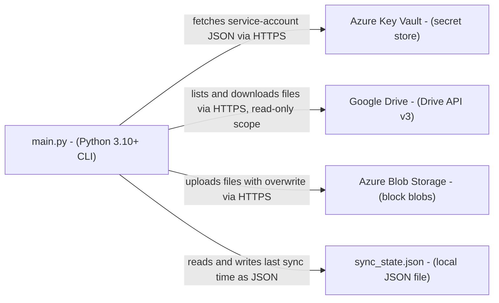
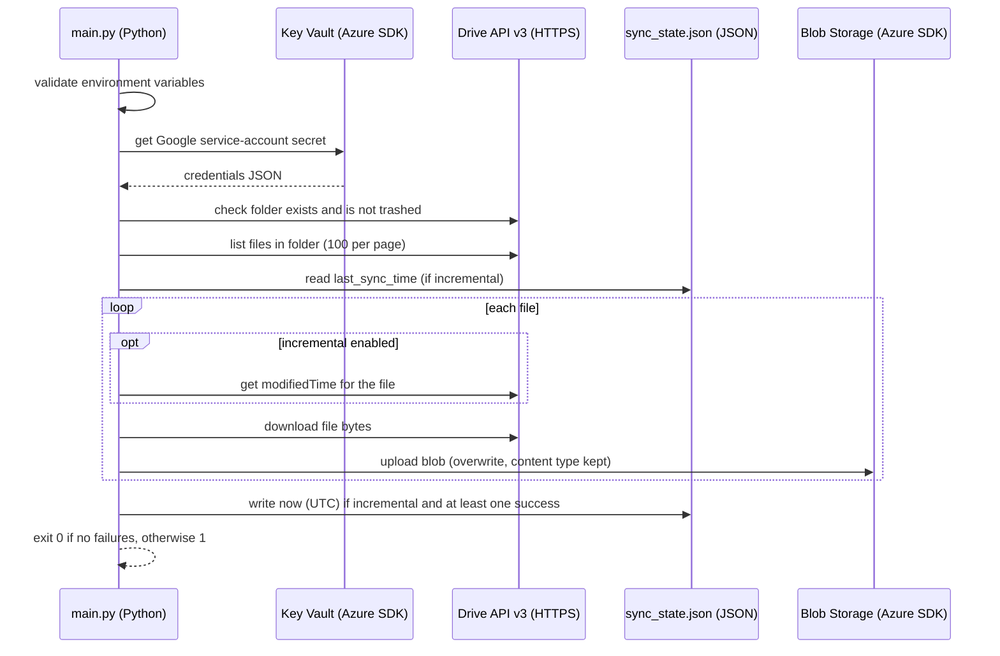

# Google Drive to Azure Blob Storage - Architecture and design rationale

*Last updated: 2026-11-07 · commit 8a9bd36d4*

## 1. Purpose and scope

A small Python command-line job that copies the files in one Google Drive folder into one Azure Blob Storage container,
optionally copying only files changed since the previous run. It is a personal backup tool and a learning project for
combining the Google Drive API, Azure Key Vault and Azure Blob Storage.

It is not a production backup service. It has not been load-tested, it is single-user and single-process, and it does
not propagate deletions, recurse into sub-folders or handle Google-native documents (see section 8). Setup and usage are
in the [README](../README.md) and [Setup Instructions](../Setup%20Instructions.md); this file explains the design.

## 2. How this project was built

This project was built with Claude Code (Anthropic's AI coding assistant) in a complementary role. Elliott Fairhall is
the author and owner: the project is debugged, tested and used by him for learning and development, and the design
decisions below are explained so that they can be understood, questioned and learned from. AI assistance does not
replace that work, and nothing in this repository should be read as an unreviewed, machine-only product.

## 3. Architecture at a glance

One process runs start to finish. It obtains Google credentials from Key Vault, lists the configured folder, decides
which files to transfer, and streams each one into the container. The only persistent state outside the two clouds is a
one-field JSON file on the machine that runs the job.

## 4. Components

| Component        | Responsibility                                                                        | Key files             | Depends on                                                |
| ---------------- | ------------------------------------------------------------------------------------- | --------------------- | --------------------------------------------------------- |
| Orchestrator     | Validates configuration, authenticates, loops over files, saves state, sets exit code | `main.py`             | all modules below                                         |
| Authentication   | Reads the Google service-account JSON from Key Vault; file-based alternative          | `auth.py`             | `azure-identity`, `azure-keyvault-secrets`, `google-auth` |
| Drive listing    | Confirms the folder exists, lists non-folder files with pagination                    | `get_drive_files.py`  | Drive API client                                          |
| Change detection | Compares a file's `modifiedTime` with the last sync time                              | `incremental_sync.py` | Drive API client                                          |
| State store      | Persists and reads `last_sync_time`                                                   | `state.py`            | local file system                                         |
| Blob upload      | Uploads bytes with a content type, overwriting existing blobs                         | `upload_blob.py`      | `azure-storage-blob`                                      |
| Container helper | Idempotent container creation                                                         | `create_container.py` | `azure-storage-blob`                                      |
| Logging          | Console and `logs/sync.log` file handlers                                             | `upload_logging.py`   | standard library                                          |

Behaviour that is not obvious from the names:

- `incremental_sync.py` contains `get_files_to_sync` and `get_local_modified_time`, but `main.py` only calls
  `is_file_updated`. The other two are tested but not wired in.
- `create_container.py` is not called by `main.py`; the container must already exist (or be created separately).
- `get_all_files` in `get_drive_files.py` (whole-Drive listing) is also unused by the entry point.

## 5. Data and control flow

Where state lives: `sync_state.json` in the working directory holds a single ISO timestamp. Nothing is cached in memory
between runs. Each file is downloaded fully into memory before upload.

On failure: every module catches its own errors, logs them and returns `False` or an empty result. A single failed file
increments an error counter and the loop carries on. A missing environment variable, failed authentication or missing
folder stops the run with exit code 1. Listing errors return an empty list, which the orchestrator reports as "no files
found" and exits 0 (see section 8).

## 6. Design rationale

### Incremental sync uses a single last-sync timestamp, not a per-file manifest

- **Why:** the job backs up one folder for one person. One timestamp in a small JSON file is trivially inspectable,
  deletable (`clear_state` forces a full run) and needs no database. Drive supplies `modifiedTime` for every file, so
  nothing else has to be stored.
- **Gave up:** exactness. A timestamp cannot detect deletions, renames or files whose modification time moves backwards.
  The timestamp is taken at the end of the run, so a file edited during the run can be missed until it changes again.
  Because state advances once at least one file succeeds, a file that failed in that run is not retried by the next
  incremental run.
- **Alternative not taken:** a manifest of file id to `modifiedTime` or checksum (SQLite or JSON), or the Drive Changes
  API with a stored page token. Both are more correct and would suit a larger or shared folder; both add state and code
  that a learning-sized backup does not need yet.
- **Evidence:** inferred from the code. The module docstrings state the timestamp mechanism but no file records why it
  was chosen over a manifest.

### Change detection asks Drive per file instead of reusing the listing

- **Why:** `is_file_updated` is a small, independently testable function that takes a file id and a time. The tests mock
  one API call and check five edge cases (error, missing field, timezone format).
- **Gave up:** an extra API request per file, even though the listing already requests `modifiedTime`. For a folder of a
  few hundred files this is acceptable; for thousands it is wasteful.
- **Alternative not taken:** filter on the listing result, or push the filter into the query (`modifiedTime > '...'`) so
  Drive does it server-side.
- **Evidence:** inferred from the code (listing `fields` includes `modifiedTime`; `main.py` does not use it).

### Google credentials live in Key Vault; Azure access uses `DefaultAzureCredential`

- **Why:** the Google service-account JSON is the one long-lived secret, so it is kept out of the repository and the
  `.env` file. `DefaultAzureCredential` lets the same code use the Azure CLI login on a laptop and a managed identity
  when hosted, with no change. The Drive scope is `drive.readonly`, so a leaked credential cannot alter the source.
- **Gave up:** a hard dependency on an Azure Key Vault (an extra resource and cost) for what could be a local file, and
  a more involved first-time setup.
- **Alternative not taken:** a local JSON key file. `get_credentials_from_file` exists as that fallback but is not the
  default path; an environment-variable secret would be simpler and weaker.
- **Evidence:** documented in `README.md` (Security Considerations) and `Setup Instructions.md` (Key Vault sections).

### The storage connection string stays in environment configuration

- **Why:** it keeps `upload_blob` a plain function of `(connection_string, container, name, bytes, type)`, easy to test
  and to call from a script. One person runs it locally.
- **Gave up:** this is a secret in `.env`, which contradicts the Key Vault stance for the Google key. It is the weakest
  credential handling in the project.
- **Alternative not taken:** use `DefaultAzureCredential` with the account URL and a role assignment (Storage Blob Data
  Contributor), which removes the connection string entirely.
- **Evidence:** documented as a requirement in `README.md` (Configuration table); the reasoning is inferred.

### Plain functions in flat modules, with errors converted to return values

- **Why:** the project is about 600 lines of logic and one maintainer. A flat layout with one concern per file is easy
  to read in order, and returning `bool` or empty lists lets one bad file not stop a backup.
- **Gave up:** failures are swallowed into logs. Callers cannot tell "folder empty" from "listing failed", and
  `is_file_updated` returns `False` on error, which silently skips the file.
- **Alternative not taken:** raise specific exceptions and let `main.py` decide, or a `SyncResult` object with per-file
  outcomes.
- **Evidence:** inferred from the code.

### Overwrite-in-place blobs named after the Drive file name

- **Why:** a backup that mirrors the folder is simplest if the blob name is the file name and uploads use
  `overwrite=True`, which also makes re-runs idempotent.
- **Gave up:** two Drive files with the same name overwrite each other; no version history except what the storage
  account provides if blob versioning is enabled (not set up by this repository); no folder structure.
- **Alternative not taken:** key blobs by Drive file id, or prefix with the folder path, or enable blob versioning.
- **Evidence:** inferred from `upload_blob.py` (`overwrite=True`) and `main.py` (`file_name` passed as blob name).

### Local JSON state file and file logging, no hosted scheduler

- **Why:** the README suggests cron or Task Scheduler, matching a single machine. State and logs sit next to the code,
  which suits a learning project.
- **Gave up:** state is lost if the working directory is not preserved, and a second machine would re-sync everything.
  Logging is split: `main.py` uses the configured application logger, while `upload_blob.py` and `state.py` use
  module-level loggers that are not attached to its handlers, so their messages may not reach `logs/sync.log`.
- **Alternative not taken:** keep state in Blob Storage next to the backup; run as an Azure Function on a timer.
- **Evidence:** documented in `README.md` (Scheduled Execution); the rest is inferred.

### Tests cover the pure logic; the cloud calls are not tested

- **Why:** state handling, timestamp comparison and requirements-file hygiene are deterministic and cheap to test with
  `tmp_path` and mocks, so these are covered. Exercising Drive and Azure needs credentials and cost.
- **Gave up:** no automated test of `main.py`, `upload_blob.py`, `auth.py` or `get_drive_files.py`.
- **Alternative not taken:** integration tests against Azurite (the Azure storage emulator) and a recorded Drive API.
- **Evidence:** `tests/` and commit `4011b7f88` (added an encoding guard test after `requirements.txt` was found to be
  UTF-16, which pip tooling could not read).

| Choice                        | Gain                               | Cost                                            |
| ----------------------------- | ---------------------------------- | ----------------------------------------------- |
| Single timestamp state        | Simple, inspectable                | Misses deletes; one failing file blocks advance |
| Per-file `modifiedTime` call  | Small testable unit                | One extra API call per file                     |
| Key Vault for Google key      | Secret off disk                    | Extra Azure resource and setup                  |
| Connection string in `.env`   | Simple upload function             | Long-lived secret on disk                       |
| Return values over exceptions | One bad file does not stop the run | Silent failures                                 |
| Overwrite by file name        | Idempotent re-runs                 | Name collisions, no versions                    |

## 7. Quality and testing

Run `pytest tests/ -v` from the project folder. Three test modules exist: `test_state.py` (load, save, clear, round trip
and invalid input), `test_incremental_sync.py` (timestamp comparison, API errors, missing fields, local mtime helper,
filtering) and `test_requirements.py` (the file is UTF-8 and every package has a version floor). Ruff and mypy are
configured in `pyproject.toml` and `.pre-commit-config.yaml`; commit `4011b7f88` records the last lint and type
clean-up.

Not tested: authentication, listing and pagination, download, upload, the `main()` flow and exit codes. A failure would
show as a non-zero exit code and `ERROR` lines in the console and `logs/sync.log`. This document did not run the tests
or the sync.

## 8. Constraints, limitations and known gaps

- No deletion propagation: files removed from Drive remain in the container.
- No recursion: the listing excludes sub-folders and their contents.
- Google-native files (Docs, Sheets, Slides) cannot be fetched with `get_media`; they need an export call, which is not
  implemented, so those files are counted as failures. `TODO: verify` against a real folder.
- Files are downloaded fully into memory; very large files are not handled by streaming or chunking.
- A failed listing call returns an empty list and the run exits 0 with "No files found".
- Fixed: state used to advance after any success, so files that failed were skipped next time. `main.py` now saves the
  run's start time only when every file succeeded, and `tests/test_main_state.py` covers both cases. A permanently
  failing file (for example a Google-native document) therefore blocks state from advancing, and every later run
  re-uploads all files modified since the last fully clean run.
- `main.py` uses `datetime.utcnow()` (naive, deprecated in Python 3.12); the comparison is correct only because naive
  values are treated as UTC.
- `README.md` lists an `ARM Template.json` that is not in the repository.
- `create_container_if_not_exists` is defined but not called by the entry point.
- Setup text uses Key Vault access policies; Azure's current default is role-based access control. `TODO: verify`.

## 9. Running and extending

See the [README](../README.md) for installation, configuration and scheduling.

Seams for extension: swap `upload_blob` for another destination behind the same five-argument signature; replace
`is_file_updated` with a manifest check in `main.py`; add recursion in `get_folder_files`. Change `state.py` and
`main.py` together if state grows beyond one timestamp, and keep the environment variable names in step with
`.env.example`, the README table and `validate_environment`.

## 10. Rationale (confirmed by the owner)

Confirmed by Elliott Fairhall on 2026-11-07. This reasoning was first reconstructed from the code and commit history;
the owner has since agreed it is correct, so it is now the stated rationale rather than an inference.

- The single-timestamp state design was chosen for simplicity at personal-backup scale, with the known cost of missed
  deletions and un-retried failures (reconstructed from the code, not stated anywhere).
- `drive.readonly` and Key Vault for the Google key were chosen so a leaked credential cannot modify Drive and no key
  file sits on disk; the connection string in `.env` was an accepted exception rather than a deliberate stance.
- The per-file `modifiedTime` call exists to keep `is_file_updated` a small, mockable unit rather than for efficiency.
- Overwrite-by-name uploads were chosen for idempotency, with name collisions and versioning not considered.
- `create_container.py`, `get_files_to_sync` and `get_all_files` were built as general helpers during development and
  never connected to the entry point.
- Cron or Task Scheduler on one machine is the intended deployment; hosted scheduling was not planned.
